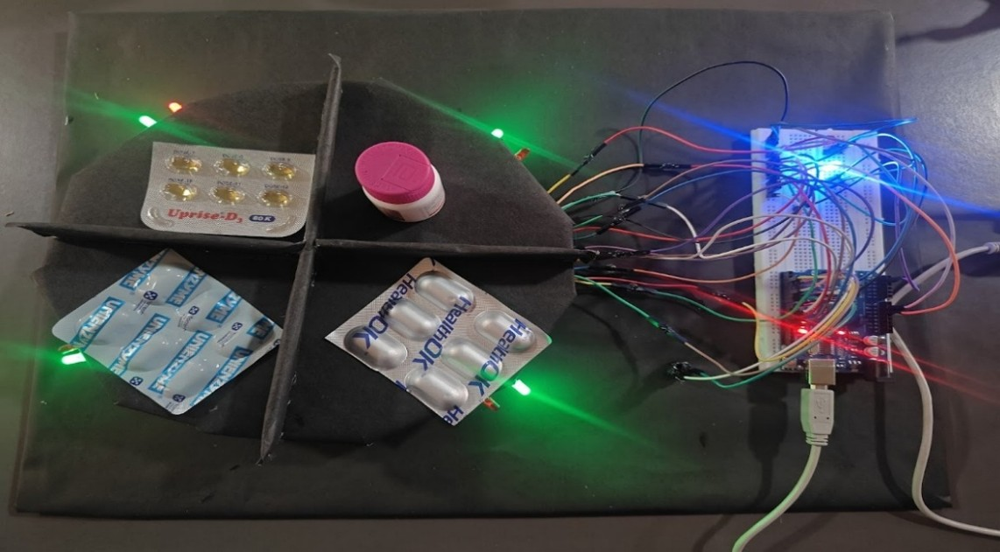

# Smart Medicine Sorting & Expiry Alert System (SMSES)

**An Arduino-based FEFO inventory management prototype using a Min-Heap and Circular Doubly Linked List.**

## Project Overview

SMSES is an academic embedded-systems prototype that organises a small medicine inventory by expiry date. It applies the **First-Expired, First-Out (FEFO)** principle: the medicine with the earliest expiry date receives the highest priority.

The Arduino UNO receives medicine records through its Serial Monitor, stores the records, maintains expiry-based priority with a Min-Heap, and uses a Circular Doubly Linked List (CDLL) to support circular slot navigation. LEDs and a buzzer provide simple visual and audio feedback.

This is an **individual project** developed for the Smart System Design course.

## Project Demonstration

### Actual Hardware Implementation



*The assembled four-slot medicine management prototype developed using Arduino UNO, breadboard connections, medicine compartments and LED indicators.*

## System Architecture

SMSES combines embedded programming with fundamental data structures to manage medicine records according to their expiry priority.

**System Workflow:**

User Input → Arduino UNO → Medicine Record Storage → Min-Heap (Expiry Prioritisation) → Circular Doubly Linked List (Slot Navigation) → LED Indicators and Buzzer.

For a detailed explanation of the architecture and its components, refer to [System Architecture Documentation](docs/system-architecture.md).

## What the Implemented Prototype Does

- Accepts a medicine batch number, expiry date, and name through manual Serial Monitor input.
- Maintains expiry priority using a Min-Heap.
- Tracks four physical medicine slots.
- Uses a CDLL to support circular slot navigation with the NEXT button.
- Uses green LEDs to show occupied slots and red LEDs to identify the highest-priority slot.
- Uses a white LED as a power indicator.
- Uses the DISPENSE button to remove the highest-priority record from the system's logical inventory.
- Provides buzzer feedback and a simulated near-expiry alert.
- Supports `LIST`, `BEEP`, and `FORCEALERT` Serial Monitor commands.

## Important Scope and Accuracy Notes

This repository documents the prototype that was actually implemented. It does **not** claim features that were only proposed as future work.

- **No physical barcode scanner was used.** Medicine details are entered manually through the Arduino Serial Monitor.
- The prototype has **four physical slots**.
- `DISPENSE` performs logical inventory removal; it does not physically dispense a medicine.
- The current implementation uses a software pseudo-timestamp based on `millis()`; it does not use a dedicated RTC module or independently maintain calendar time.
- Expiry dates in the historical demonstration inputs are retained as recorded test data. They are examples from the project demonstration, not current medicine inventory.
- This is an educational prototype, not a medical, pharmacy, or patient-safety device.

## Hardware Used

- Arduino UNO
- Four green LEDs
- Four red LEDs
- One white LED
- Buzzer
- Two push buttons (DISPENSE and NEXT)
- Breadboard and jumper wires
- Four-slot medicine tray

See [hardware/components.md](hardware/components.md) and [hardware/connections.md](hardware/connections.md).

## Pin Configuration

| Component | Arduino Pin |
|---|---:|
| DISPENSE button | D6 |
| NEXT button | D8 |
| Buzzer | D7 |
| Green LED — slot 0 | D10 |
| Red LED — slot 0 | D11 |
| Green LED — slot 1 | D12 |
| Red LED — slot 1 | D13 |
| Green LED — slot 2 | D4 |
| Red LED — slot 2 | D5 |
| Green LED — slot 3 | D2 |
| Red LED — slot 3 | D3 |
| White power LED | A4 |

The buttons use `INPUT_PULLUP`; each button is connected between its input pin and GND. Each LED requires a suitable current-limiting resistor.

## Data Structures Used

### 1. Min-Heap

The Min-Heap stores medicine record indices and orders them by expiry value. The root represents the smallest expiry value.

- Read the minimum: **O(1)**
- Insert: **O(log n)**
- Remove the minimum: **O(log n)**

### 2. Circular Doubly Linked List (CDLL)

The CDLL maintains links between occupied slot positions. The NEXT button advances the list head to the next occupied slot, wrapping around in circular order.

### 3. Fixed-Size Arrays and Records

A fixed-size `Item` structure array stores each medicine's batch number, name, expiry value, assigned slot, and active state. Additional arrays maintain heap positions, slot-to-record mapping, and CDLL links.

## Input Format and Commands

Open Arduino IDE's Serial Monitor and configure:

- **Baud rate:** 115200
- **Line ending:** Newline

Enter medicine records in this format:

```text
BATCH:201;EXP:2025-01-05;NAME:Paracetamol
```

### Available Commands

| Command | Purpose |
|---|---|
| `LIST` | Displays stored records and their status |
| `BEEP` | Tests the buzzer |
| `FORCEALERT` | Changes the current top record's simulated expiry to trigger the near-expiry demonstration |

The `FORCEALERT` command is a demonstration aid; it changes the simulated expiry value in memory.

## Historical Demonstration Inputs

The original historical sample records are retained in [demo/historical-test-inputs.txt](demo/historical-test-inputs.txt). Their dates have intentionally **not** been changed to current dates.


## Repository Contents

```text
smart-medicine-sorting-expiry-system/
│
├── README.md
├── LICENSE
├── .gitignore
│
├── src/
│   └── SMSES.ino
│
├── docs/
│   ├── SMSES_Final_Project_Report.pdf
│   ├── system-architecture.md
│   └── images/
│       └── smses-hardware.jpg
│
├── hardware/
│   ├── components.md
│   └── connections.md
│
└── demo/
    └── historical-test-inputs.txt
```

## How to Run the Project

1. Install the Arduino IDE.
2. Connect the Arduino UNO to your computer using USB.
3. Open `src/SMSES.ino` in Arduino IDE.
4. Select **Arduino Uno** under Tools → Board.
5. Select the correct serial port under Tools → Port.
6. Verify and upload the sketch.
7. Open Serial Monitor at 115200 baud and select Newline.
8. Enter a medicine record or use `LIST`, `BEEP`, and `FORCEALERT`.
9. Test the NEXT and DISPENSE buttons and observe the LEDs and buzzer.

Check the wiring documentation before powering the circuit.

## Academic Report

The submitted final academic report is included unchanged at [docs/SMSES_Final_Project_Report.pdf](docs/SMSES_Final_Project_Report.pdf). It is preserved as the final submitted report and is not rewritten as part of this repository preparation.

## Individual Project Contribution

This was developed as an individual course project. The work covered:

- Arduino program development.
- Implementation of the Min-Heap and Circular Doubly Linked List.
- Medicine record handling and expiry-based prioritisation.
- Hardware interfacing with Arduino UNO.
- LED and buzzer control.
- Push-button functionality.
- Functional testing and project demonstration.
- Technical documentation and GitHub repository preparation.

## Future Enhancements

The final academic report discusses possible future extensions, including:

- Barcode-scanner integration.
- Real-Time Clock (RTC) module integration.
- Automated physical dispensing.
- Environmental monitoring.
- Mobile application integration.
- Cloud-based inventory management.
- Increased storage capacity.
- Enhanced data security.

These are **future-scope ideas**, not features claimed as implemented in this version.

## Disclaimer

SMSES is a student learning prototype for demonstrating data structures and embedded programming. It must not be used to decide whether a medicine is safe to consume, to replace professional expiry checks, or to control real medicine dispensing.

---

**Project Type:** Individual Academic Project  
**Course:** Smart System Design  
**Platform:** Arduino UNO  
**Programming Language:** Embedded C/C++  
**Core Data Structures:** Min-Heap and Circular Doubly Linked List
