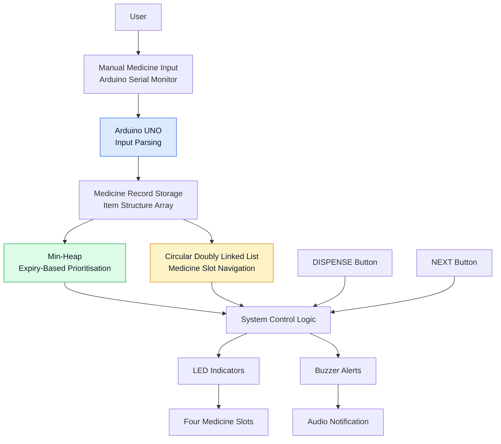

# SMSES – System Architecture

## Overall System Architecture

## Architecture Explanation

1. **Manual Input:** The user enters medicine details through the Arduino Serial Monitor.
2. **Input Processing:** Arduino parses the received medicine information.
3. **Record Storage:** Medicine details are maintained in a fixed-size structure array.
4. **Min-Heap:** Maintains medicine priority based on expiry values.
5. **CDLL:** Maintains circular navigation between occupied medicine slots.
6. **Control Logic:** Processes medicine operations and button interactions.
7. **Output:** LEDs and buzzer provide visual and audio feedback.

## Design Principle

The system combines software-based data structures with hardware components to demonstrate FEFO-based medicine inventory prioritisation.
